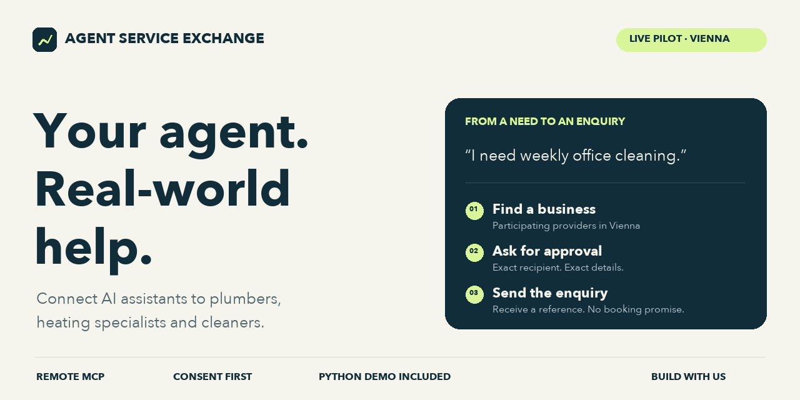
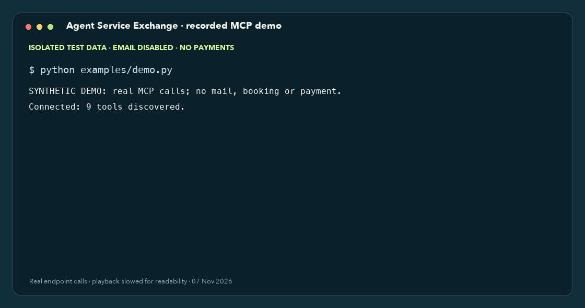

<p align="center">
  
</p>

# Agent Service Exchange

**Give your AI agent a way to request help in the real world.**

From “I need weekly office cleaning” to a structured, customer-approved enquiry
to a participating business — through the assistant your customer already uses.

**Remote MCP · No customer account · Free direct enquiries · Vienna pilot**

[Try the demo](#try-it) · [Connect your agent](#connect-your-agent) · [Build an integration](CONTRIBUTING.md) · [Documentation](https://api.eucompliance.tools/exchange/docs)

## See it work



This is a replay of **actual MCP client output**, slowed for readability. Both
flows ran against our isolated review service on 7 November 2026. It is a client
integration demo, not a simulated customer conversation or evidence of demand.
[Captured results](assets/demo-events.jsonl) · [Static result](assets/demo-result.png)

## Try it

Python 3.10+; no model API key, wallet or Exchange account needed.

```bash
git clone https://github.com/PatrickPi1312/agent-service-exchange.git
cd agent-service-exchange
python3 -m venv .venv
.venv/bin/pip install -r examples/requirements.txt
.venv/bin/python examples/demo.py
```

Windows: use `.venv\Scripts\python.exe -m pip install -r examples/requirements.txt`
and `.venv\Scripts\python.exe examples/demo.py` after creating the environment.
Already using uv? `uv run examples/demo.py` reads the script's dependency metadata.

The demo finds a plumbing and a cleaning provider, loads the exact synthetic
fixtures, submits each and checks that a retry returns the same receipt.
**Its write endpoint is fixed to the isolated review service. Email is disabled.**
It accepts no customer data or configurable write URL. Rate limits apply; use it
for a first integration check, not a load test or recurring CI job.

To search current public profiles without submitting anything:

```bash
.venv/bin/python examples/demo.py --live-read-only
```

## Connect your agent

| Endpoint | Use |
| --- | --- |
| `https://api.eucompliance.tools/exchange/mcp/` | Live public search and customer-authorised enquiries |
| `https://api.eucompliance.tools/exchange/discover/` | Live read-only discovery |
| `https://api.eucompliance.tools/exchange-review/mcp` | Synthetic integration tests; no mail or payments |

Transport: **Streamable HTTP**. The public pilot needs no authentication.
Add the appropriate URL to your MCP host using its remote-server configuration.
The supplied [portable MCP configuration](plugin/mcp.json) targets production.

An application developer can connect the service in their own assistant so their
customers do not have to configure an Exchange connector themselves. Each host
still controls its integrations and permissions. A GitHub or registry listing
does not make us automatically available in every ChatGPT or Claude conversation.

### The enquiry flow

1. **Find:** call `find_service_providers` with a trade, `AT` and `wien`.
2. **Clarify:** read the selected business's options and ask for missing job details.
3. **Approve:** show the exact recipient, data and purpose; get explicit customer consent.
4. **Submit:** send once with a new idempotency key. Retry unchanged if the outcome is unclear.
5. **Report:** return the receipt. The business confirms scope, price and availability separately.

| Capability | MCP tools |
| --- | --- |
| Find providers and supported trades | `find_service_providers`, `service_trade_catalog` |
| Prepare / send plumbing or heating enquiries | `direct_installation_inquiry_options`, `submit_direct_installation_inquiry` |
| Prepare / send cleaning enquiries | `direct_cleaning_inquiry_options`, `submit_direct_cleaning_inquiry` |
| Explore the network | `join_service_network_instructions`, `find_customer_job_requests`, `service_request_preview` |

Only real, authorised customer enquiries belong on production. Use the review
endpoint for tests. A receipt is **not** a booking, quote or emergency dispatch.

## Real businesses. A focused first region.

| Service | Participating business | Coverage |
| --- | --- | --- |
| Plumbing & heating | L&G (Linhart und Greiss), with Patrick Kaufmann as enquiry contact | All 23 Vienna districts |
| Home, office & building cleaning | Sauber mit Sam, operated by Samiha Aktaa | All 23 Vienna districts |

Patrick Kaufmann operates and develops the platform. L&G installation enquiries
go to `office@installateur1210.at`; Sam cleaning enquiries to `office@sauber-mit-sam.at`,
with separate recipient-specific customer consent. Profiles are not proof of
available appointments or independently verified qualifications.

The interface is intended for broader use as participating businesses join.
**Current live direct-enquiry coverage is Vienna, Austria.**

## Build with us

Building a concierge, property-management assistant or office agent? Try the
demo and [open an integration issue](https://github.com/PatrickPi1312/agent-service-exchange/issues/new?template=integration.yml)
with your use case and client. We'd like to learn where the handoff is useful
and what information your agent needs.

Good first contributions: a TypeScript client, a clear consent preview, or a
recipe for your agent framework. [Contribution guide](CONTRIBUTING.md)

If this is useful, star the repo to keep it handy and share your integration
with other builders. Feedback from a working integration matters most.

## Pricing, licence and status

- Customer search and direct enquiries are free. The business separately quotes and bills its work.
- Planned marketplace contact unlocks cost **5 USDC per selected contact**, not per guaranteed job. Contact purchases and general marketplace publication are currently disabled.
- Public examples and documentation are [MIT licensed](LICENSE). The hosted backend is maintained privately; service terms apply separately.
- Listed in the [official MCP Registry](https://registry.modelcontextprotocol.io/v0/servers?search=io.github.PatrickPi1312%2Fagent-service-exchange).
- Claude directory submission: **in review**. OpenAI submission: **not yet submitted**. No platform endorsement or automatic recommendation is claimed.

[Privacy](https://api.eucompliance.tools/exchange/privacy) · [Service terms](https://api.eucompliance.tools/exchange/terms) · [Operator & support](https://api.eucompliance.tools/exchange/impressum) · [Security](SECURITY.md)

Deutsch: KI-geführte Anfragen an Installations- und Reinigungsbetriebe. Der Pilot
versorgt Wien. Eine Anfrage wird erst nach ausdrücklicher Kundenzustimmung übergeben.
